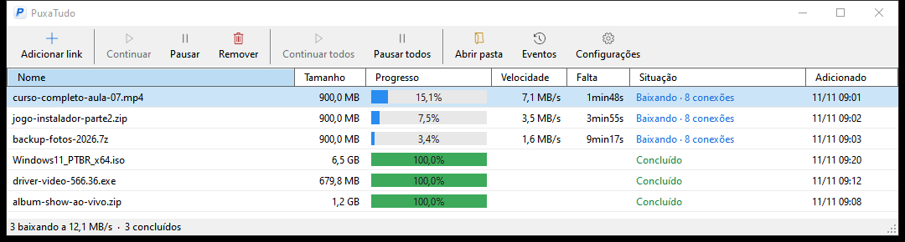
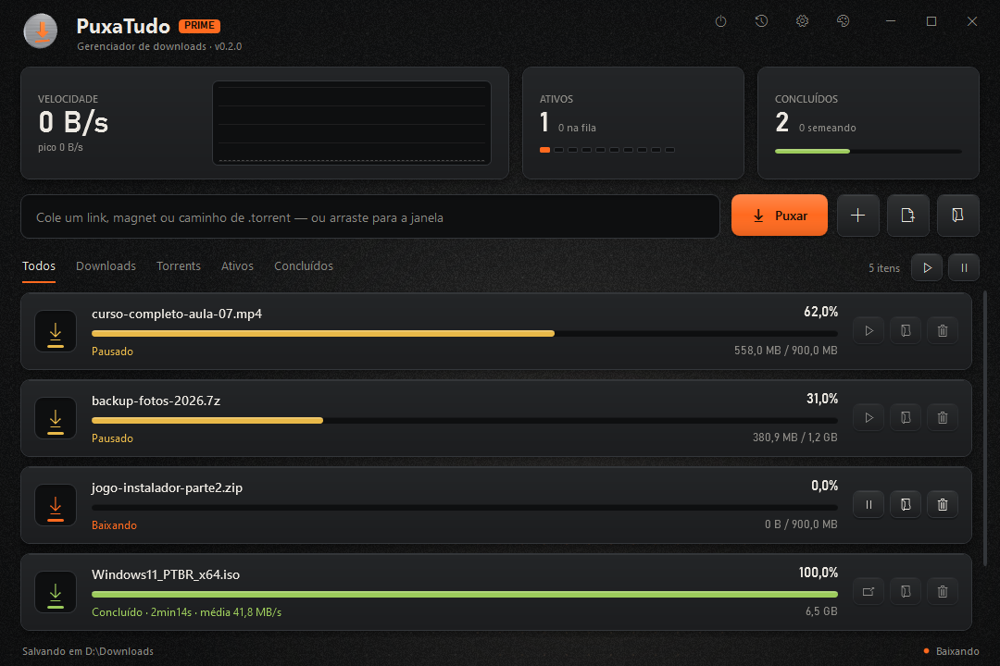

🇧🇷 [Português](README.md) | 🇺🇸 **English**

# PuxaTudo Light

**Download and torrent manager for Windows: faster downloads from slow or distant servers, pause and resume where you left off, and grab downloads straight from your browser.**

---

## About

**PuxaTudo** is a download manager for Windows. It splits each file into several connections at the same time,
which makes a big difference when the server is slow or far away (another country, another continent).
If your internet drops or the computer shuts down, the download resumes where it stopped. With the extension,
just click a file link in your browser and PuxaTudo takes over the download right away.
The program is available in **Portuguese and English**: switch it in Settings → Appearance → Idioma / Language
(the first time, it follows your Windows language).

## Features

| Area | What it does |
| --- | --- |
| **Multiple connections** | Up to 32 connections per file. Starts with one and only opens more when that makes the download faster; backs off if the server refuses or slows down |
| **Pause and resume** | Pause at any time and resume where you left off, even after closing the program or restarting the PC |
| **Download queue** | Choose how many files download at once; the rest wait in the queue |
| **Browser extension** | Catches the download when you click the link, before the browser starts, or takes over what the browser already started, with no duplicate file |
| **Right-click menu** | "Baixar com PuxaTudo" (Download with PuxaTudo) on any link, image or video |
| **Sites that need a login** | The extension passes the site's cookies to the program, so downloads that require an account also work |
| **System tray** | Stays next to the clock, opens by itself when the extension sends a download, and lets you know when it finishes |
| **Events** | History of what happened to each download, with the reason for every failure |

## Trial version

The version available here is a **trial**:

- it works for **48 hours** from the first time you open it;
- it uses up to **2 connections** per download;
- it downloads **one file at a time**.

When the trial ends, your browser simply goes back to downloading on its own.

## Download and installation

1. Download **[`PuxaTudo-Light-1.1.2.msi`](https://github.com/Isago2508/PuxaTudo/raw/main/downloads/PuxaTudo-Light-1.1.2.msi)**.
2. Open the file. If you see "Windows protected your PC", click **More info → Run anyway**.
   The warning appears because the program is new and does not have a digital signature yet.
3. Follow the setup wizard. You don't need to install .NET: it is already included.

**Requirements:** Windows 10 or 11, 64-bit.

## Browser extension

The extension is what makes your browser hand downloads over to PuxaTudo. It needs the program installed:
on its own, it doesn't download anything. The program, on the other hand, works without the extension; just paste the link into it.

Until the extension is available in the browser stores, it has to be installed manually:

| Browser | File |
| --- | --- |
| Chrome, Edge, Opera, Brave, Vivaldi | [`PuxaTudo-chrome-0.2.0.zip`](https://github.com/Isago2508/PuxaTudo/raw/main/downloads/PuxaTudo-chrome-0.2.0.zip) |
| Firefox | [`PuxaTudo-firefox-0.2.0.xpi`](https://github.com/Isago2508/PuxaTudo/raw/main/downloads/PuxaTudo-firefox-0.2.0.xpi) |

Step-by-step instructions for each browser are in [COMO-INSTALAR-A-EXTENSAO.txt](downloads/COMO-INSTALAR-A-EXTENSAO.txt) (in Portuguese).
In short, for Chrome-based browsers: unzip the file, open the extensions page (`chrome://extensions`, `edge://extensions` or `opera://extensions`),
turn on **Developer mode** and click **Load unpacked**, choosing the unzipped folder.

**Note:** the extension's own panel is currently in Portuguese only.

**Tips:** hold **Alt** while clicking to leave a link to the browser. In the extension's icon you can turn each option on or off,
choose the file types and set a minimum size.

## Coming soon: PuxaTudo Prime

**PuxaTudo Prime** is the next version of the program, still in development. It does everything Light does
(multiple connections, torrents, browser extension, queue, tray) with a brand-new look:

- dashboard with a speed graph, active and finished downloads;
- downloads and torrents in the same list, as cards, with filters;
- four themes (Graphite, Slate, Wine and Paper), font choice and sounds on completion;
- drop a link, magnet or .torrent file onto the window and you are done.

Prime is not available for download yet. It will show up here when it is released.
## Privacy

PuxaTudo does not collect or send data to any server. The download address, the source page and the site's cookies
only go from the extension to the program, inside your own computer. The download list is stored in `%LOCALAPPDATA%\PuxaTudo`.

## Support

Found a problem or have a suggestion? Open an [issue](https://github.com/Isago2508/PuxaTudo/issues).

---

© 2026 Isago2508. All rights reserved. Free to use, but copying, redistributing, modifying or decompiling PuxaTudo without permission is prohibited. See the [license](LICENSE).
