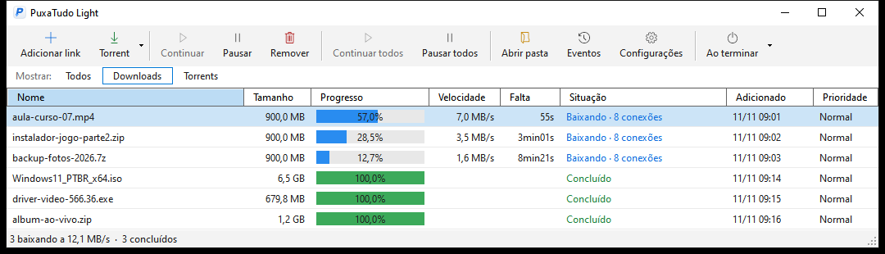

🇧🇷 **Português** | 🇺🇸 [English](README.en.md)

# PuxaTudo

**Gerenciador de downloads para Windows: baixa mais rápido de servidores lentos ou distantes, pausa e continua de onde parou, e pega os downloads direto do navegador.**

---

## Sobre

O **PuxaTudo** é um gerenciador de downloads para Windows. Ele divide cada arquivo em várias conexões ao mesmo tempo,
o que faz muita diferença quando o servidor é lento ou fica longe (outro país, outro continente).
Se a internet cair ou o computador desligar, o download continua de onde parou. Com a extensão,
basta clicar no link do arquivo no navegador: o PuxaTudo assume o download na hora.
O programa está disponível em **português e inglês**: troque em Configurações → Aparência → Idioma / Language (na primeira vez, ele segue o idioma do Windows).

## Recursos

| Área | O que faz |
| --- | --- |
| **Várias conexões** | Até 32 conexões por arquivo. Começa com uma e só abre mais se isso deixar o download mais rápido; recua se o servidor recusar ou ficar mais lento |
| **Pausar e continuar** | Pausa a qualquer hora e continua de onde parou, mesmo depois de fechar o programa ou reiniciar o PC |
| **Fila de downloads** | Escolha quantos baixam ao mesmo tempo; o resto espera na fila |
| **Extensão do navegador** | Pega o download no clique do link, antes de o navegador começar, ou assume o que o navegador já começou, sem arquivo duplicado |
| **Botão direito** | "Baixar com PuxaTudo" em qualquer link, imagem ou vídeo |
| **Sites com login** | A extensão passa os cookies do site ao programa, então downloads que exigem conta também funcionam |
| **Bandeja do sistema** | Fica perto do relógio, abre sozinho quando a extensão manda um download e avisa quando termina |
| **Eventos** | Histórico do que aconteceu com cada download, com o motivo de cada falha |

## Versão de teste

A versão disponível aqui é a de **teste**:

- funciona por **48 horas** a partir da primeira vez que é aberta;
- usa até **2 conexões** por download;
- baixa **um arquivo por vez**.

Quando o teste termina, o navegador volta a baixar sozinho, normalmente.

## Download e instalação

1. Baixe o **[`PuxaTudo-1.1.0.msi`](https://github.com/Isago2508/PuxaTudo/raw/main/downloads/PuxaTudo-1.1.0.msi)**.
2. Abra o arquivo. Se aparecer "O Windows protegeu o computador", clique em **Mais informações → Executar assim mesmo**.
   O aviso aparece porque o programa é novo e ainda não tem assinatura digital.
3. Siga o assistente. Não é preciso instalar o .NET: ele já vem junto.

**Requisitos:** Windows 10 ou 11, 64 bits.

## Extensão do navegador

A extensão é o que faz o navegador entregar os downloads ao PuxaTudo. Ela precisa do programa instalado:
sozinha, não baixa nada. Já o programa funciona sem a extensão; é só colar o link nele.

Enquanto a extensão não está nas lojas, a instalação é manual:

| Navegador | Arquivo |
| --- | --- |
| Chrome, Edge, Opera, Brave, Vivaldi | [`PuxaTudo-chrome-0.2.0.zip`](https://github.com/Isago2508/PuxaTudo/raw/main/downloads/PuxaTudo-chrome-0.2.0.zip) |
| Firefox | [`PuxaTudo-firefox-0.2.0.xpi`](https://github.com/Isago2508/PuxaTudo/raw/main/downloads/PuxaTudo-firefox-0.2.0.xpi) |

O passo a passo de cada navegador está em [COMO-INSTALAR-A-EXTENSAO.txt](downloads/COMO-INSTALAR-A-EXTENSAO.txt).

**Dicas:** segure **Alt** ao clicar para deixar um link com o navegador. No ícone da extensão dá para ligar ou desligar
cada opção, escolher os tipos de arquivo e um tamanho mínimo.

## Privacidade

O PuxaTudo não coleta nem envia dados a nenhum servidor. O endereço do download, a página de origem e os cookies do site
passam só da extensão para o programa, dentro do seu computador. A lista de downloads fica em `%LOCALAPPDATA%\PuxaTudo`.

## Suporte

Encontrou um problema ou tem uma sugestão? Abra uma [issue](https://github.com/Isago2508/PuxaTudo/issues).

---

© 2026 Isago2508. Todos os direitos reservados. O uso é gratuito, mas copiar, redistribuir, modificar ou descompilar o PuxaTudo sem autorização é proibido. Veja a [licença](LICENSE).
